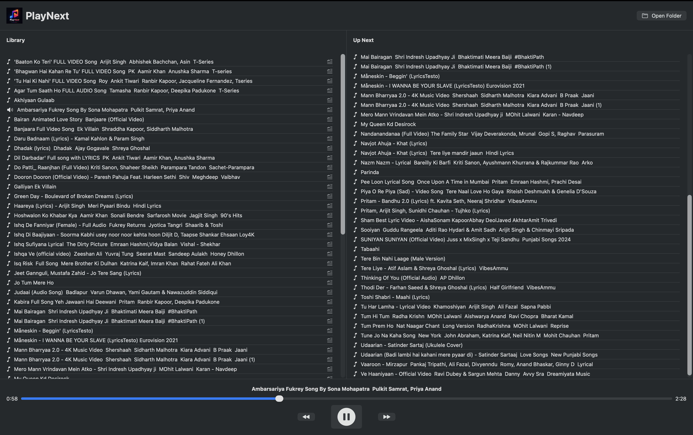

# PlayNext

A lightweight, native macOS music player built with SwiftUI and AVFoundation.

Play music directly from folders on your Mac, manage your playback queue, and jump to any part of a song using the progress slider.

## Features

- **Folder-based library** — Select a music folder from your Mac and load its songs.
- **Audio playback** — Play, pause, resume, and switch between tracks.
- **Play Next** — Add a song to play immediately after the current track.
- **Playback queue** — View your current playback queue.
- **Previous and Next** — Navigate between tracks.
- **Seek through songs** — Use the interactive progress slider to jump to any position.
- **Native macOS interface** — Built with SwiftUI.
- **Custom branding** — PlayNext app icon and in-app logo.

## Screenshots

**PlayNext Dashboard**


## Built With

- Swift
- SwiftUI
- AVFoundation
- Observation
- Xcode

## Getting Started

### Requirements

- A Mac running a compatible version of macOS
- Xcode compatible with the project

### Run from Source

1. Clone this repository:

   ```bash
   git clone https://github.com/AtharvaShah-Git/PlayNext.git
   ```

2. Open `MusicPlayer.xcodeproj` in Xcode.
3. Select the **MusicPlayer** scheme and **My Mac** as the run destination.
4. Build and run the application.

## Download

Prebuilt macOS releases will be published on the [GitHub Releases](https://github.com/AtharvaShah-Git/PlayNext/releases) page when available.

## Project Structure

```text
MusicPlayer/
├── Assets.xcassets/
├── Managers/
│   └── PlayerManager.swift
├── Models/
│   ├── MusicLibrary.swift
│   └── Song.swift
├── Views/
│   ├── PlayerControls.swift
│   ├── QueueView.swift
│   └── SongRow.swift
├── ContentView.swift
└── MusicPlayerApp.swift
```

## License

This project is licensed under the MIT License. See [LICENSE](LICENSE) for details.

## Author

**Atharva Shah**

GitHub: [@AtharvaShah-Git](https://github.com/AtharvaShah-Git)